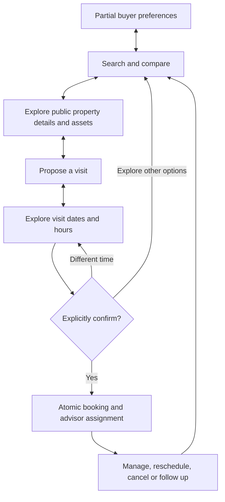
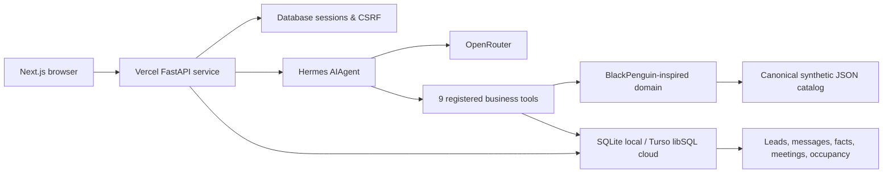

# Testing Hermes Agent — House Sales Evaluation Lab (v7)

A **single-screen evaluation workspace** for [Nous Research Hermes Agent](https://github.com/NousResearch/hermes-agent), OpenRouter, a **synthetic house-for-sale** catalog modeled after BlackPenguin's Project/Property Type/Unit/Lead contracts, and a shared advisor calendar.

**Stack:** Next.js 15 + React 19 + FastAPI + upstream Hermes `AIAgent` + OpenRouter `openai/gpt-4o-mini` + SQLite (local) / Turso **libSQL** (Vercel). The source is independent research code, not Nous Research or BlackPenguin production software.

> [!IMPORTANT]
> Use **fictional leads**. Do not enter customers' real contact details. Booking, people, properties, inventory, calendar fixtures, and PDFs are synthetic; this demo does **not** sync Google Calendar or contact humans. OpenRouter calls may be billable.

## What changed from v3

- **Single workspace, one sidebar link:** Inventory / Calendar left, Hermes chat center, per-lead structured state right.
- **Complete approved-property inspector:** type/model/unit distinctions, areas, prices, inventory timestamps, verified typed features, local demo images/PDFs, and safe source JSON.
- **No extra contextual agent button:** all conversational actions stay in chat. AI messages render Markdown safely; only approved local media and public property gallery URLs are clickable.
- **Real calendar UI:** day/week, any subset of advisors, daily time-grid, multi-advisor events, available slots, occupied visits, buffers, viewer-local date/time marker, optional project-time mode, and expanded view. Refreshed every 20 seconds and after chat actions.
- **Auth and durable leads:** administrator-only sign-in (no evaluator selector); a strong administrator password is recommended. Create leads with first/last name, email, phone; reopen all leads from any administrator session, including historical v4 leads.
- **Shared scheduling:** 45-minute appointments plus 15-minute buffer; candidates every 30 minutes; three expiring proposals without holds; automatic revalidation; atomic 15-minute advisor occupation keys to reject overlapping concurrent bookings across visitors.
- **Permanent admin deletion:** removes the lead, conversations, messages, Hermes histories, fact evidence, interest records, offers, meetings and occupancy allocations. Other tabs get 404 and clear their state on refresh; no application-level historical viewer remains.
- **No browser-held signed transcript:** the backend owns Hermes continuation history and DB sessions are revocable. `DEMO_SIGNING_SECRET` now also signs the CSRF token.

## v7 — House sales only (synthetic)

- **Sales only:** project scope is `transaction_type=sale`, published categories are `house` only. The generic BlackPenguin model remains extensible for later companies; there are no rental or condo listings in this demo.
- **Four published new houses:** `H-201` (2 bedrooms, **$245,000**, ready now), `H-204` (3 bedrooms, **$295,000**, available December 15, 2026), `H-101` (3 bedrooms, **$320,000**, ready now), `H-104` (4 bedrooms, **$395,000**, available March 1, 2027). All are *fictional*, with original demo illustrations and unit-specific PDFs. Reserved `H-102` remains unpublished.
- **New units instead of relabeling apartments:** former `A-201` and `A-204` have been removed from the active source catalog. New unit and property-type IDs avoid falsely changing historical identities. No persisted lead messages, interests or meetings are rewritten. Historical conversations may still mention retired codes; they cannot be rebooked as current inventory.
- **AI-first introduction:** new leads receive `I'm the AI Sales Agent assigned to help you...`. The same identity appears in Hermes's prompt and chat labels; old transcript text is preserved as historical evidence.
- **Matching safeguard:** verified lead maximum budget is enforced server-side, minimum bedrooms are respected, exact bedroom-count matches rank before surplus bedrooms, and houses over budget are never listed as matches. Hermes still decides when to invoke business tools via `AIAgent.run_conversation()`.
- **Source of truth:** edit `shared/blackpenguin/{project,property_types,units,assets}.json`, run `python scripts/build_catalog_from_blackpenguin.py`, then `python scripts/generate_demo_assets.py` (requires `reportlab` installed). Do **not** manually edit generated `shared/catalog.json` or `backend/app/catalog.json`.
- **Media:** `/properties/H-201/gallery` and equivalent URLs aggregate only the given unit's images. A PDF in a unit card is a synthetic *fact sheet*, not a licensed construction plan or project-level brochure. Retired apartment asset files are retained on disk only to avoid breaking previously shared historical links, but are not in the public catalog.

## v13.1 — Budget capture and zero-match reliability

This release fixes the Nov 21 demo conversation: a buyer requested a 2-bedroom
house, then explicitly stated "I do not want to spend more than $200k".
Previously, three `update_search_preferences` calls and three
`search_properties` calls were rejected, while the budget stayed `unknown`.
The exported customer JSON is **not** committed; only anonymized utterances
are used in tests.

- **One commercial write path:** direct buyer budget caps (including "do not
  want to spend more than") are recorded as permanent limits with source
  evidence. Initial bedroom statements generate one revision instead of
  a minimum followed by an immediately superseding preference.
- **Conversation memory as evidence:** `search_properties` accepts identical
  bedroom counts and budget amounts from the saved profile even if absent
  from the newest buyer message. Different, unsupported counts remain rejected.
- **After-update catalog search:** a verified preference change recalculates
  results before Hermes replies. Repeated identical successful search tool calls
  reuse a per-turn response instead of appending duplicate sessions.
- **No matches is a success:** out-of-budget houses are never presented as
  matches. A verified closest option can be offered as an explicitly labeled
  alternative with its exact excess. With a $200k maximum, H-201 costs $245k,
  **$45k over** the limit; the limit remains unchanged.
- **Agent-safe delivery:** responses that leak internal validation/retrieval
  problems, imply nonexistent exact matches, or conceal the price deviation
  are repaired from catalog facts. The real agent still owns the conversation
  when it gives a correct, natural answer.
- **Observability:** repeated failed tool calls are marked as cached
  rejections rather than new successful operations. The active search and
  answer remain separate from visit drafts and permanent preferences.
- **Regression coverage:** anonymized unit tests plus full HTTP, mocked Hermes
  and SQLite persistence reproduce the two user turns. CI remains necessary
  but not sufficient: manually test the real model/OpenRouter and Turso in a
  preview environment with synthetic leads before merging.

## v13 — Agent-Native Commercial Orchestration

Hermes remains the conversational agent, while our tools own verifiable business
data and transactions. The real upstream Nous Research Hermes \`AIAgent\`
remains pinned to \`b94cb8e2c4ebf2a8c7688cf676c3cf9899584adb\`.

### Conversation and state contract

- **Exploration is not a permanent profile edit.** A new request for 3-bed
  options while the profile prefers 2 beds uses an isolated \`active_search\`
  record. The original main budget and bedroom preferences survive. A clear
  buyer declaration ("Now I prefer 3 bedrooms") may revise them with evidence.
- **Independent parallel concerns:** \`conversation_focus\` represents the
  current property topic; \`active_search\` the latest search; \`visit_draft\`
  the requested appointment; \`visit_planning_paused\` indicates exploration
  interrupted a booking discussion. The lead is free to resume any of them.
- **Typed agent tool:** \`search_properties\` derives effective constraints
  from the saved profile plus the current buyer message, verifies typed model
  filters against buyer evidence, returns ground-truth matching inventory and
  logs whether the search was temporary. It never modifies a visit draft.
- **Public facts vs buyer searches:** search requests cannot trigger a
  stale-property detail prefetch or the \`_verified_fact_reply\` repair hook.
  The outbound policy checks the current search's matched unit IDs. If Hermes
  omits a clear search, a restricted, catalog-grounded recovery provides a
  relevant answer instead of the old property's price.
- **Assets:** when helpful, a property detail/gallery reply may mention the
  existence of unshared approved photos or PDFs once per house. Only
  explicitly requested links are delivered. A fact sheet is not a floor plan.
- **Journey UI:** the sidebar marks Exploration / Details / Visit as the
  current phase and separately displays temporary matching options and
  any paused visit to another property.
- **Commercial memory:** source messages, search sessions, presented options,
  answered topics and actually shared assets remain in persisted lead state.

### Hermes library integration

We use the documented \`AIAgent.run_conversation()\` loop, scoped domain
toolset, and server-owned \`conversation_history\`. A stable
\`ephemeral_system_prompt\` describes business procedures; verified
turn-specific context is supplied with the current user turn via
\`persist_user_message\`, which is supported by the pinned Hermes commit.
The actual buyer message (not the enriched envelope) is retained in the
Hermes continuation. \`skip_memory=True\` prevents cross-lead memory leakage
in a process-global Hermes home; Turso owns per-lead commercial facts and
conversation history. Runtime tool registration remains serialized and
allowlisted. We do not enable unrestricted terminal, web or files.

### Invariants

1. Searching and viewing a property do not authorize a visit or permanent
   preference revision.
2. Existing maximum budgets remain effective unless the buyer explicitly
   requests to explore or adopt a higher maximum.
3. The backend exclusively validates slots, consent, advisor allocation and
   database commits; no confirmation before the transaction succeeds.
4. Source evidence is required for persistent preference changes and tool-
   provided criteria; responses cannot cite unapproved properties or URLs.
5. No customer data or secrets may be included in synthetic regression fixtures.

### Review before merging

Run \`PYTHONPATH=backend python -m pytest -q backend/tests\`, regenerate the
catalog and verify no differences, and \`cd frontend && npm install && npm run
build\`. GitHub Actions performs these checks. Also test Hermes/OpenRouter/Turso
on a non-production Preview with fictional leads, especially **a paused H-201
visit interrupted by "other 3-bedroom homes under my $300k budget"**. CI tests
cover deterministic contracts and a complete HTTP/Turso-like mocked turn,
not live language-model reliability. Do not auto-merge this PR.

## v12 — Contextual Sales Graph & Commercial Memory

v12 fixes the **Nov 21 property-details confirmation loop**. The buyer asked for
H-201's area, but Hermes repeatedly received rejected `get_unit_details`
and `track_property_interest` results because the only presented option had
not been promoted to conversational focus. A property question **never**
requires interest declaration or appointment consent.

### Conversational graph (not a mandatory linear funnel)



**Independent source-of-truth dimensions:**

- `conversation_focus` identifies the house being discussed. The
  `last_presented_units` list preserves the ordering of options actually
  sent, so "the second" can reference the right house. A sole recent option
  resolves "it", "that property" and a follow-up "What is the area?".
  Multiple recent options remain ambiguous until identified.
- `search_preferences` stores revisable hard/soft budget and bedroom
  criteria. `property_filters` adds incremental built-area, bathroom,
  parking, open-kitchen and backyard filters, plus comparisons relative
  to an identified house, without silently overwriting budget caps.
- `answered_topics` and the BlackPenguin dialogue's
  `memory.answered_topics` record **actually delivered** property facts,
  keyed by property, topic and message evidence. `shared_media` records
  verified links already sent, so follow-up requests can explicitly resend.
- `visit_draft` is independent of exploration: asking about H-204 does not
  transfer a pending H-201 visit. Booking confirmation and any reprogramming
  still require explicit consent and transactional availability validation.
- `conversation_phase` and `conversation_transitions` describe the
  current *activity*, not an authorization gate. Buyers can return to
  searches/details at any time.

**Hermes remains the conversational tool agent.** Backend resolution
does not infer buying intent. Catalog-backed read-only factual prefetch
provides the verified facts in context. When Hermes misreads a clear
public question as needing confirmation, the outbound policy repairs
only that fact from the approved catalog. Unknown/ambiguous references
must be clarified, never guessed. Repeated rejected tool calls are
cached within the current turn with an actionable reason.

### Review and regression

- `backend/tests/test_v12_contextual_sales_graph.py`: 17 new
  anonymized cases covering the original error, property switching,
  ordinal references, all-at-once filters, relative comparisons,
  delivered-topic memory, media resend and booking separation.
- GitHub Actions validates Python syntax, all backend tests and the
  Next.js build; additionally check Hermes/OpenRouter/Turso behavior in
  Preview with **fictional leads**. Backend tests do not constitute
  a live LLM evaluation.
- The synthetic property catalog and exact booking consent rules remain
  authoritative. No real houses, appointments or physical addresses.

## v11 — Dynamic Sales Preferences & Reliable Booking (review branch)

- Buyer criteria are revisable: search_preferences stores a budget floor, cap,
  approximate target, fixed funds and exact listing price separately, with
  preferred/exact/min/max bedroom modes and a history of source messages.
- A requested 2-bedroom property is a preference for two bedrooms, not silently
  a 2-bedroom minimum. Three-bedroom houses are optional alternatives, and
  unsolicited alternatives do not count as verified matches.
- Hermes can discover approved photos and PDFs for the focused house without
  sending links. Only the specifically requested asset may be sent, while other
  approved resources can be suggested by name. Unit fact sheets are NOT plans.
- Availability searches on different days no longer erase an hour selected by
  the buyer. "Following day" refers to the last offered exact date.
- Reservations require one unambiguous acceptance of a full house/date/hour
  recap. Bare "Ok" is not consent. A server-side completion guard prevents
  missing tool calls from forcing redundant confirmations.
- The authoritative booking confirmation comes only from a successful atomic
  database transaction. A failed reschedule must not remove the original.
- The weekly calendar exposes every slot through expansion, and can follow a
  date requested in chat. The right sidebar shows budget constraints and
  actual saved vs provisional agent operations.
- All people, inventory, location links, calendar events and visits are fictional.

### v11 review checklist

Run PYTHONPATH=backend python -m pytest -q backend/tests, regenerate the
catalog and compare generated outputs, then cd frontend && npm ci && npm run build.
Review CI and test the Preview with fictional leads before merging. Do not
merge automatically or modify main before approval.

## v10 — focus continuity and graceful scheduling

- `conversation_focus` tracks the unambiguously discussed house; `visit_draft` independently tracks the house, date and time of the requested visit. Browsing another listing does not redirect a pending appointment.
- Appointment searches accept exact dates, relative week/weekend periods, and a morning/afternoon/evening preference. They distinguish `NO_SLOTS`, `AMBIGUOUS_PROPERTY`, `DATE_OUTSIDE_HORIZON`, `INVALID_DATE`, and `CALENDAR_UNAVAILABLE`; repeated within-turn queries return the cached outcome.
- Unit locations contain synthetic city-level Google Maps references, **not** real house pins, showroom directions or verifiable physical addresses.
- Hermes still selects tools via upstream `AIAgent`. Explicit lead consent, chosen hours, atomic advisor assignment and booking revalidation remain enforced in the backend.
- Regression checks are in `backend/tests/test_focus_and_slots_v10.py`. No real customers or physical appointments are involved.

## Architecture



**Source of truth:** `shared/blackpenguin/*.json` owns the synthetic project, types, units, features, assets, advisors, availability and policy. Run `python scripts/build_catalog_from_blackpenguin.py` to regenerate the two read-only copies of the approved public catalog. The backend's database owns mutable lead/conversation/booking state. **Do not commit database files or secrets.**

Upstream Nous `hermes-agent` is pinned to commit `b94cb8e2c4ebf2a8c7688cf676c3cf9899584adb` for Python 3.12 compatibility; it is a sizeable dependency for serverless. Its writing of logs/sessions is redirected to `HERMES_HOME=/tmp/hermes-agent` in Vercel/AWS Lambda automatically when this variable is not set.

### Insecure convenience credentials for synthetic testing (opt-in only)

By default, the signing secret requires at least 32 characters and the administrator
password requires at least 16 characters. For an **isolated, synthetic-only test**
you can opt into the following intentionally insecure configuration:

```dotenv
DEMO_SIGNING_SECRET=demo
DEMO_ADMIN_PASSWORD=demo
DEMO_ALLOW_WEAK_CREDENTIALS=true
```

**Do not enable this on a publicly shared or production deployment.** The
administrator credential becomes publicly guessable: any visitor who tries
`demo` can view and permanently delete *all* leads. The signing key is also
predictable, degrading CSRF integrity. Use a strong signing key and a distinct
administrator password when publishing the URL. The switch is disabled unless
set explicitly and never overrides stronger credentials.

## Local setup

Requirements: Node.js 20+, Python 3.12, `pip`, Git, OpenRouter API key.

```bash
cd backend
python -m venv .venv
source .venv/bin/activate   # PowerShell: .venv\Scripts\Activate.ps1
pip install -r requirements.txt
# Set OPENROUTER_API_KEY, DEMO_SIGNING_SECRET, DEMO_ADMIN_PASSWORD
# in your shell/environment (do not commit them).
uvicorn main:app --reload --port 8000
```

The first authorized request initializes `data/hermes_demo.sqlite3` (standard Python `sqlite3`). It also seeds two **absolute-time** synthetic occupied appointments once, including one on an advisor's other project. Existing appointments will never move merely because a day passes or you restart the app.

```bash
cd frontend
npm install
LOCAL_API_URL=http://127.0.0.1:8000 npm run dev
```

Open `http://localhost:3000`, enter the administrator password and create a fictional lead. All administrator sessions can access the same existing leads. The session uses a seven-day HttpOnly, SameSite=Lax cookie. Evaluator sessions from previous versions cannot access the v5 API; historical leads remain available to administrators.

Tests (Hermes calls mocked, no OpenRouter charge):

```bash
python scripts/build_catalog_from_blackpenguin.py
PYTHONPATH=backend python -m pytest -q backend/tests
cd frontend && npm run build
```

## Deploy to Vercel with Turso libSQL

**Important:** Vercel Functions' `/tmp` is ephemeral and not shared. Do **not** set `DEMO_DATABASE_PATH=/tmp/demo.db` for persistent state. Use a remote database accessible by every instance.

1. Create a database at [Turso](https://turso.tech/) using the **libSQL** engine. With the Turso CLI, `turso db create hermes-agent-lab` without `--tursodb` creates a libSQL database. Check current Turso documentation if the default engine changes.
2. Obtain its `libsql://...` URL and a database auth token. The current backend reads the Marketplace-provided `TURSO_DATABASE_URL` and `TURSO_DATABASE_TURSO_AUTH_TOKEN`. Store both privately.
3. Import the entire repository into Vercel at root `./`, keeping its `vercel.json` **Services** configuration (Next.js frontend + FastAPI backend).
4. Add these **Production** environment variables in **Vercel → Project → Settings → Environment Variables**:

| Variable | Required | Notes |
|---|---|---|
| `OPENROUTER_API_KEY` | Yes | Secret API key; requires usable credit/permissions. |
| `MODEL_NAME` | Optional | `openai/gpt-4o-mini` by default. |
| `DEMO_SIGNING_SECRET` | Yes | Unique high-entropy string, >=32 characters. |
| `DEMO_PUBLIC_BASE_URL` | Optional | Public site origin for absolute gallery/PDF links returned to Hermes. Defaults to `https://testing-hermes-agent-alpha.vercel.app`. |
| `DEMO_ACCESS_CODE` | No | Deprecated: ignored with administrator-only login. |
| `DEMO_ADMIN_PASSWORD` | Yes for admin | Separate high-entropy string, >=16 characters. |
| `TURSO_DATABASE_URL` | Yes | `libsql://...` URL from a Turso libSQL database. |
| `TURSO_DATABASE_TURSO_AUTH_TOKEN` | Yes (Marketplace) | Current remote adapter reads the Turso Marketplace-provisioned token. Never expose with `NEXT_PUBLIC_`. |
| `TURSO_AUTH_TOKEN` | Legacy | Ignored by the current Marketplace-specific adapter; was used in earlier versions. |
| `HERMES_HOME` | No | Automatically `/tmp/hermes-agent` on Vercel; may be set explicitly. |

5. Save and **redeploy**. Visit `/api/health` (`database_mode: "turso"` only indicates configuration; not connectivity), then sign in, create a lead and request calendar availability.
6. Check **Vercel Runtime Logs** if chat fails. The initial app startup and Hermes's first API request may expose further packaging/runtime issues.

Database initialization is lazy on first authorized request and is idempotent for a single deployment. On first use the database creates all tables and seeds the synthetic fixed-time fixtures once; later deployments preserve leads and appointments.

**A new Turso-engine database (`--tursodb`) uses a different driver.** This repository's remote adapter specifically uses the `libsql` Python driver for libSQL databases. Provision the **libSQL** flavor or adapt the storage driver after validating its transactional/occupancy behavior. Do not silently use a local file on Vercel as a fallback.

## API contracts

| Method | Endpoint | Access |
|---|---|---|
| GET | `/api/health` | Public, configuration summary only |
| GET | `/api/catalog` | Public, approved synthetic catalog only |
| POST | `/api/auth/login` | Administrator password only |
| GET | `/api/me` | Active signed-in session and CSRF token |
| POST | `/api/auth/logout` | Signed-in, CSRF header |
| GET | `/api/leads` | Administrator; all leads |
| POST | `/api/leads` | Signed-in + CSRF; four contact fields |
| GET | `/api/leads/{id}` | Administrator |
| POST | `/api/leads/{id}/chat` | Administrator + CSRF; only message text allowed |
| GET | `/api/calendar?start=YYYY-MM-DD&days=7&advisor_ids=ADV-01,ADV-02` | Signed-in; other visitors' contact details redacted |
| DELETE | `/api/admin/leads/{id}` | Administrator + CSRF only; hard deletion |

All state-changing authenticated requests require `X-Demo-Csrf`. The browser's session cookie is HttpOnly and request responses include `Cache-Control: no-store`. The browser never posts Hermes tool history.

### Business tools

- `get_project_overview`
- `evaluate_properties_for_lead`
- `get_unit_media`
- `update_lead_profile`
- `track_property_interest` (discussed / considering / explicitly interested)
- `get_available_visit_slots`
- `book_onsite_visit`
- `cancel_onsite_visit`
- `reschedule_onsite_visit`

Offers expire after 30 minutes and **do not hold** any capacity. A booking is accepted only on subsequent explicit consent. Two concurrent sessions may both *see* an open slot, but the first successful database transaction reserves all four 15-minute occupancy buckets. A conflicting commit is rolled back and the API responds 409, never confirming an overlapping booking.

### Permission and deletion model

The only interactive role is administrator. Existing evaluator sessions from earlier versions are rejected, but their historical leads remain visible to administrators. The administrator can inspect and delete all leads. Deleting a lead removes all application-owned lead data and releases booking occupancy keys transactionally. Historical browser tabs may temporarily show already-rendered messages until the next refresh/poll; endpoints immediately reject access after deletion.

Application-level deletion **cannot purge Turso/provider backups, external AI-provider logs, browser screenshots, already downloaded exports, or third-party retention policies**. Use only synthetic leads, do not log message content to Vercel, rotate demo credentials if disclosed, and review privacy/retention settings with service providers. For a commercial app add a real identity provider, rate limiting, governance, and stronger administrative authentication.

### Known limits / deliberately out of scope

- **No real Google Calendar** or human follow-up, email, WhatsApp, SMS, property sale, or payments.
- **No real users' PII**: all data is fictional. Administrator login is password-only and requires deployment edge rate limiting for public exposure.
- 14 messages per lead in the interactive evaluation. A new lead starts a new evaluation, so the OpenRouter spend limit is **not** a global hard cap.
- Remote Turso transactional correctness (including multi-instance Vercel concurrency), serverless Hermes cold-start/size limits and full Next.js production build must be verified with **real deployed credentials**, not inferred from local SQLite tests.
- Existing v3 browser `sessionStorage` sessions are **not migrated** to v4; use new fictional leads.
- If account access to GitHub does not authorize writes, apply the supplied patch locally. A PR/deployment has not been performed by generating this archive.

For details, see [`docs/V4_ARCHITECTURE.md`](docs/V4_ARCHITECTURE.md).

## Property media and single administrator access (v5)

- Public approved galleries use `/properties/<UNIT_CODE>/gallery` (e.g. `/properties/H-201/gallery`). The link requires no login and displays only approved images explicitly associated with that unit. When no approved images exist, no gallery link is advertised.
- Each unit's documents contain **only** approved PDF assets with explicit `unit_id` coverage. Project/general brochures are not inherited into unit cards or `get_unit_media`. The legacy `floorplan_brochure_pdf` field remains solely for existing consumers; the canonical documents collection is `media.documents`.
- Hermes `get_unit_media` returns one absolute gallery URL (when present) and unit-only PDF links. Set `DEMO_PUBLIC_BASE_URL` if the application has a different public domain. The frontend allows only trusted gallery/PDF paths in Markdown.
- The login form has one administrator password; the server rejects `role=evaluator`, and existing evaluator cookies can no longer access protected endpoints. Existing lead records remain intact for administrators.
- **Security:** using `demo` as the administrator password with `DEMO_ALLOW_WEAK_CREDENTIALS=true` allows anyone who knows it to view and permanently delete all leads. This is suitable only for controlled synthetic-data testing.

## v6: chronologically ordered conversations and live profile

Chat messages now show browser-local dates and `HH:mm:ss`; old mixed-zone message rows are upgraded in place and ordered by a stable per-conversation sequence. The lead panel shows validated facts and message provenance, with provisional previews from Hermes tool executions over authenticated POST/SSE and a final Turso commit. See [v6 architecture and migration notes](docs/V6_CHRONOLOGY_LIVE_PROFILE.md).

## V8 — visit scheduling, SMS and exports

The v8 improvement adds:

- **45-minute visit + 15-minute buffer**, with **hour-aligned start times only**; date-first anonymous availability ranges; an explicit lead-selected house and hour; later affirmative consent; server-side round-robin advisor assignment after the Turso transaction commits. The buyer does **not** choose or see an advisor before confirmation.
- **SMS-compatible plain-text** Hermes messages, direct HTTPS links and GSM-7 / UCS-2 segment visualization. Long replies are split into SMS-sized chat bubbles rather than silently truncated. The demo does not send SMS.
- **One-click JSON export** with the lead, saved structured state and ordered messages, and **Copy** on individual messages.
- A **Project focus** sidebar with selected house and explicitly fictional visit address. Maps links remain unavailable until a verified address is configured.
- A read-only, administrator-only `/api/admin/storage` endpoint showing a stable database URL fingerprint and aggregate record counts. **Deployments do not delete Turso records**; compare fingerprints to detect accidental changes of database or Preview branch.
- Optional pinned Production connection with the **paired** `DEMO_PERSISTENT_TURSO_URL` and `DEMO_PERSISTENT_TURSO_TOKEN`, which overrides the Marketplace-managed URL/token pair only when *both* are supplied.

Full contract, deployment instructions, safety considerations and acceptance tests: [V8_BOOKING_SMS_EXPORT.md](docs/V8_BOOKING_SMS_EXPORT.md).

## v9 — Progressive Hermes sales conversations

See [docs/V9_PROGRESSIVE_SALES.md](docs/V9_PROGRESSIVE_SALES.md). The first greeting is now part of the Hermes continuation history, matching results are intentionally brief, and a new `get_unit_details` tool supplies facts for the single house the lead asks about. Media links require an explicit buyer request and are checked against approved URLs before saving a turn. The right sidebar distinguishes the house being explored from the house chosen for an onsite visit. No new Turso tables or credential changes are required.
