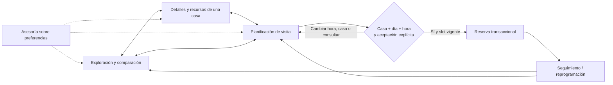
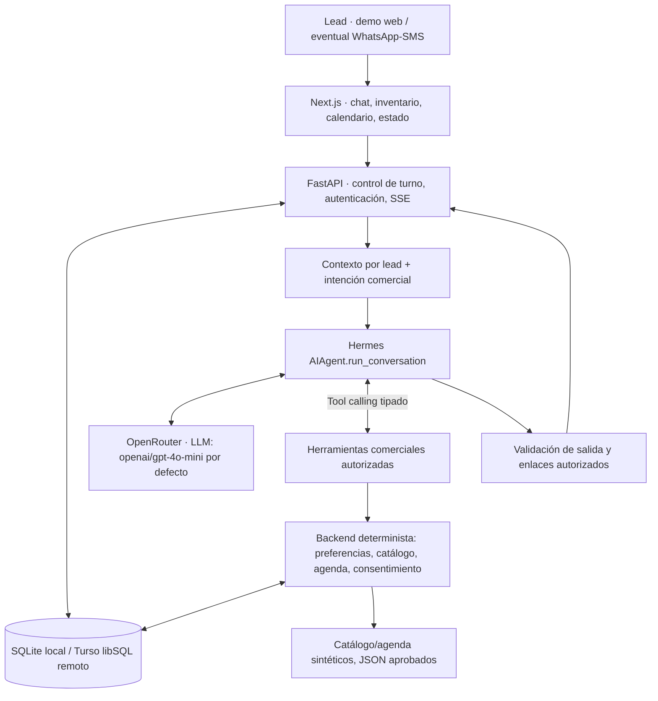

# Hermes Agent Lab · Asesor inmobiliario conversacional (v13.2)

**Demo técnica y comercial** de un agente que acompaña a un comprador desde la búsqueda de casas hasta la solicitud y confirmación de una visita. Utiliza [Hermes Agent de Nous Research](https://github.com/NousResearch/hermes-agent), un LLM vía OpenRouter y servicios propios de negocio. **No es un portal de venta real**: datos de propiedades, imágenes, asesores, agendas, precios y reservas son sintéticos.

## Qué experimenta el comprador

1. **Explora:** expresa uno o varios criterios (precio, dormitorios, área, cocina, estacionamiento). El agente muestra coincidencias reales y distingue alternativas que incumplen requisitos. Si no hay coincidencias, lo explica y puede ofrecer una opción cercana indicando la diferencia.
2. **Profundiza:** pregunta por una casa concreta o la compara con otras, recibe datos verificados, galería y PDF únicamente cuando los solicita. El agente recuerda qué materiales ya compartió.
3. **Decide libremente:** puede cambiar de casa, explorar opciones fuera de presupuesto o regresar a una búsqueda anterior en cualquier momento. Las preferencias principales no cambian por el solo hecho de preguntar o visitar una alternativa.
4. **Agenda:** consulta fechas, días de una semana y horas exactas. Si pide las 8:00 a. m. y solo hay horas desde las 9:00, se le comunica el resultado de **todo el periodo consultado**. Una hora aceptada entre varios días queda como preferencia, no como fecha seleccionada.
5. **Confirma:** recibe un resumen explícito **casa + día + hora**; un simple «OK» no confirma. La asignación del vendedor físico y la reserva se determinan únicamente tras una transacción válida. El agente no realiza el cierre de la venta presencial.

Si una alternativa supera los criterios habituales (presupuesto, dormitorios, área, baños, estacionamientos, cocina o patio), Hermes **ofrece una vez** actualizar solo las preferencias afectadas o mantenerla como **excepción de interés**. La oferta no bloquea consultas ni agendamiento y no cambia ningún dato hasta una aceptación explícita; una declaración inequívoca de cambio se registra directamente con evidencia.

## Grafo comercial — no es un embudo rígido



Las fases indican **la actividad actual**, no bloquean transiciones. Se conservan por separado las preferencias principales, los filtros de la búsqueda actual, la casa en discusión, las casas de interés y el borrador de visita. Un mensaje como «¿y los otros días de esa semana?» conserva la casa asociada a la visita; nombrar otra casa para pedir información **no cambia** una propuesta existente. Una nueva casa para visita solo se selecciona ante una intención verificable del comprador; toda disponibilidad se vuelve a comprobar. Si el LLM menciona otra casa en una respuesta de horarios, el backend recupera el inmueble correcto sin modificar la cita.

## Arquitectura y responsabilidades



| Pieza | Decide / verifica |
|---|---|
| **LLM en OpenRouter** | Interpreta lenguaje, referencias, intención y redacta respuestas comerciales. Es un modelo usado **dentro** de Hermes; no es Hermes en sí. |
| **Hermes (`AIAgent`)** | Mantiene el bucle de razonamiento y llamadas a herramientas, usa el historial cargado y el contexto del turno. El registro de herramientas está limitado al dominio del proyecto; sin terminal, navegación general ni memoria global de otros leads. |
| **FastAPI / servicios propios** | Valida criterios con evidencia, propiedades publicadas, URLs aprobadas, disponibilidad real del simulador, fechas/horas, consentimiento, conflictos, identidad del vendedor y persistencia atómica. La autoridad de reserva **nunca** se delega al LLM. |
| **Frontend Next.js** | Expone mensajes, hechos confirmados con evidencia, intereses, búsqueda actual/histórica, fase del diálogo, cita pendiente y actividad de herramientas. No interpreta ni sobrescribe el estado de negocio. |
| **SQLite / Turso** | Guarda conversaciones ordenadas, historial de continuación Hermes por lead, contacto, revisiones de preferencias, filtros/búsquedas, intereses/excepciones y fuentes, materiales enviados, ofertas de citas, reservas, ocupación y operaciones. El acceso requiere sesión administrativa, CSRF y permisos. |

**Flujo de un turno:** (1) FastAPI recupera el estado persistido y el mensaje → (2) resuelve referencias sin autorizar compromisos nuevos → (3) Hermes recibe instrucciones estables, historial y contexto aislado por lead → (4) el LLM decide llamadas a herramientas → (5) servicios verifican catálogo y operación → (6) se comprueban respuesta, enlaces y consentimiento; los fallos de enlace se reparan de forma segura, no se publican → (7) se guardan estado + mensajes y se notifica por streaming. Un turno fallido no se publica como reserva confirmada.

**Memoria:** `search_preferences` + historial = requisitos principales; `active_search`/`search_sessions` = búsquedas temporales y definitivas; `conversation_focus` = tema del diálogo; `property_interests` y `preference_update_proposals` = interés y asesoría sin cambios automáticos; `visit_draft`, `booking_offers`, `confirmation_request` = planificación/consentimiento; `shared_media`/`answered_topics` = información ya entregada; `tool_observations` = ejecuciones y rechazos reales. Los detalles del buyer no se guardan en `MEMORY.md` global de Hermes.

## Datos sintéticos de esta demo

**Proyecto:** Residencial Jardines del Sol (Lima, Perú). Publicación de cuatro casas en venta:

| Código | Dormitorios | Precio | Área construida | Disponibilidad |
|---|---:|---:|---:|---|
| H-201 | 2 | USD 245,000 | 110 m² | Inmediata |
| H-204 | 3 | USD 295,000 | 135 m² | 15 dic 2026 |
| H-101 | 3 | USD 320,000 | 150 m² | Inmediata |
| H-104 | 4 | USD 395,000 | 215 m² | 1 mar 2027 |

Las galerías y fichas PDF son específicas de cada unidad: una ficha **no es un plano**. Las referencias de Maps son **ilustrativas a escala de ciudad**, no pines verificados ni direcciones físicas para citas reales. Los vendedores, franjas disponibles, citas, historial y base de datos de prueba también son ficticios. La capacidad de agenda del simulador son visitas de 45 minutos más un buffer de 15 minutos; los slots no quedan reservados al ofrecerse y se revalidan al confirmar. No hay integración real con Google Calendar ni envíos de SMS/WhatsApp.

**Fuentes editables:** `shared/blackpenguin/{project,property_types,units,assets}.json` y fixtures de `backend/app/`. Regenerar las copias de catálogo con `python scripts/build_catalog_from_blackpenguin.py` y los recursos demo con `python scripts/generate_demo_assets.py`. No editar manualmente el catálogo generado.

## Uso local y verificación

Requisitos: **Python 3.12**, Node.js 20+, clave de OpenRouter. Configurar `OPENROUTER_API_KEY`, `DEMO_SIGNING_SECRET` (al menos 32 caracteres) y `DEMO_ADMIN_PASSWORD` (al menos 16) como secretos de entorno. `MODEL_NAME` es opcional. La librería upstream Hermes está fijada en el commit `b94cb8e2c4ebf2a8c7688cf676c3cf9899584adb`.

```bash
cd backend
python -m venv .venv
source .venv/bin/activate # PowerShell: .venv\Scripts\Activate.ps1
pip install -r requirements.txt
uvicorn main:app --reload --port 8000
# En otra terminal:
cd frontend
npm ci
LOCAL_API_URL=http://127.0.0.1:8000 npm run dev
```

Abrir `http://localhost:3000` e iniciar sesión como administrador. Pruebas sin consumo de OpenRouter:

```bash
PYTHONPATH=backend python -m pytest -q backend/tests
python scripts/build_catalog_from_blackpenguin.py
cd frontend && npm run build
```

La instancia local usa SQLite; el despliegue serverless necesita Turso **libSQL**, `TURSO_DATABASE_URL` y `TURSO_DATABASE_TURSO_AUTH_TOKEN` (o el par de override persistente documentado en `docs/V8_BOOKING_SMS_EXPORT.md`). Establecer `DEMO_PUBLIC_BASE_URL` para el origen de enlaces sintéticos. Las APIs de chat y streaming requieren sesión administrativa/CSRF. **No usar datos personales de clientes ni activar credenciales demo débiles en entornos públicos.**

## Qué demuestra y qué no

**Demuestra** un agente integrado con datos autorizados, herramientas transaccionales, memoria comercial específica por lead, búsqueda reversible y una experiencia de evaluación observable. **No demuestra** una conversión de ventas medida, una tasación real, una cita física con vendedor, una financiación garantizada ni una plataforma de producción multiempresa. Antes de integrarlo a un negocio hay que conectar el CRM/ERP y catálogo reales, identidad y consentimientos, canal oficial, calendarios de asesores, monitorización, revisión legal y pruebas con el modelo real.

Documentación previa: [`docs/V4_ARCHITECTURE.md`](docs/V4_ARCHITECTURE.md), [`docs/V8_BOOKING_SMS_EXPORT.md`](docs/V8_BOOKING_SMS_EXPORT.md) y [`docs/V9_PROGRESSIVE_SALES.md`](docs/V9_PROGRESSIVE_SALES.md).
