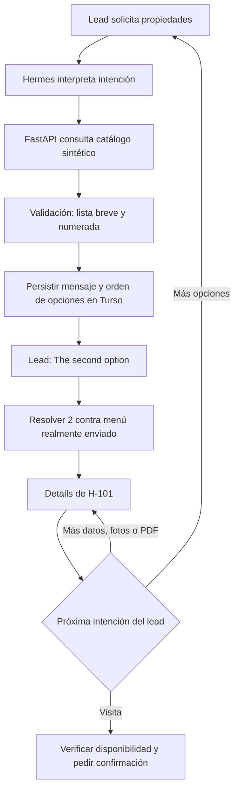

# Hermes v13.3.1 — Corrección de integración

Esta entrega es un **diferencial para aplicar manualmente** sobre el commit v13.3 `ce58c928bacbf7621f252aaceb3acac4e06f9ca5`. No contiene un checkout completo. El archivo `apply.py` modifica los diez archivos descritos en [APPLY_INSTRUCTIONS.md](APPLY_INSTRUCTIONS.md).

## Funcionamiento tras aplicar



Hermes y el LLM son responsables del diálogo y la selección de herramientas. El backend mantiene contratos verificables: el catálogo es la fuente de propiedades y precios, el historial determina qué opciones se ofrecieron, el lead controla sus preferencias y solo el consentimiento explícito permite una reserva. Una elección de detalles no activa búsqueda ni calendario.

**Ejemplo sintético de exploración:**

```text
I found 2 3-bedroom houses:

1. H-204 (3 beds, $295k)
2. H-101 (3 beds, $320k)

Which would you like to explore? I can also look for homes with different features.
```

Al seleccionar `2`, el sistema conserva la preferencia principal de 2 dormitorios, registra H-101 como propiedad en discusión, mueve la fase a `property_details` y mantiene sin cambios el borrador de cita. Se persisten los mensajes, la lista efectivamente presentada (`last_presented_property_options`), las preferencias con evidencia y la actividad comercial mediante la transacción normal de Turso; un nuevo menú sustituye al anterior. El frontend renderiza la lista y la proyección SMS conserva los saltos de línea.

El README principal del repositorio también se actualiza **al aplicar** el diferencial. Consulta las instrucciones y las limitaciones de pruebas antes del commit.
