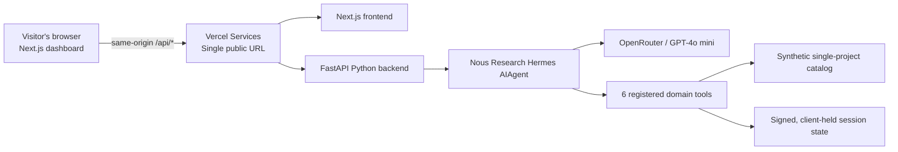

# Hermes Agent — Real Estate Sales Lab

**An interactive experiment with Nous Research's [`hermes-agent`](https://github.com/NousResearch/hermes-agent)**, OpenRouter and a synthetic residential real-estate sales journey.

> **Demo / research only.** This repository is not a live real-estate service, and is not an official Nous Research project. All listings, contact details, advisors, illustrations, brochures, and bookings are fictional. Do not enter real personal data.

The full-stack monorepo targets **Vercel Services**: a Next.js frontend and a Python/FastAPI backend deploy together under one public URL, with no database needed for a one-session-per-browser demonstration.

## What we're testing

A lead comes from a Meta Ads form interested in a single project, **Evergreen Park Residences**. The agent, **Ava**, should:

1. Qualify their **approximate budget** and **estimated purchase timeframe** before presenting suitable units.
2. Track stated facts in **live structured lead state**, right next to the chat, using Hermes tool calling.
3. Compare four constructed homes on budget, bedrooms and the anticipated move-in date.
4. Share only available gallery images and brochure PDFs, acknowledging absent media honestly.
5. Explain that personalized **financing must be discussed with a human advisor on site**; never fabricate rates or installments.
6. Offer valid advisor availability, then simulate a **45-minute onsite visit with a 15-minute buffer**.

### Demo user interface

| Panel | What it shows |
|---|---|
| **01 · Knowledge base** | One synthetic project, four apartments/houses with price, area, bedrooms, bathrooms, availability, highlights, local gallery images and downloadable synthetic PDF sheets; three advisors. |
| **02 · Live sales chat** | English conversation with the Hermes-backed agent, starter prompt shortcuts, 14-turn session limit and optional visitor access code. |
| **03 · Lead intelligence** | Live field-by-field capture, qualification stage, matched units, booking confirmation and tool activity events, updated after every completed agent response. |

## Architecture



The **Hermes agent is real**: the backend imports `AIAgent` from `run_agent`, registers its tools with `tools.registry.registry`, and runs multi-turn `run_conversation`. It is **not** merely a frontend that calls an OpenAI chat API. Hermes is installed from a **pinned Python 3.11-compatible commit** for reproducibility:

`b94cb8e2c4ebf2a8c7688cf676c3cf9899584adb`

Hermes' source is a separate upstream dependency and can be heavy for serverless cold starts. Check build logs and plan limits. We haven't verified a real Vercel deployment or OpenRouter conversation in this repository: both require your connected accounts and API key.

### Agent tools

| Tool | Purpose |
|---|---|
| `get_project_overview()` | Project details and amenities |
| `evaluate_properties_for_lead(max_budget_usd, target_purchase_timeframe?, min_bedrooms?)` | Pricing and readiness matches |
| `get_unit_media(unit_id)` | Exact gallery and PDF URLs, including explicit absence |
| `get_available_visit_slots(date_str?)` | Available advisor hours split into 60-minute blocks |
| `book_onsite_visit(...)` | Validated, simulated 45-minute booking |
| `update_lead_profile(...)` | **Additional sixth tool** recording the structured lead profile shown live in the sidebar |

The AIAgent uses `enabled_toolsets=["evergreen_real_estate_demo"]` and `disabled_toolsets=["terminal", "file", "web", "browser"]`, `quiet_mode=True`, `skip_memory=True` and a domain-specific English system prompt. Only the six domain tools are exposed to the model.

## Deploy to Vercel from GitHub

**Vercel Services is beta**. The official configuration is in the repository root `vercel.json`:

```json
{
  "services": {
    "frontend": { "root": "frontend/", "framework": "nextjs" },
    "backend": { "root": "backend/", "entrypoint": "main:app" }
  },
  "rewrites": [
    { "source": "/api/(.*)", "destination": { "service": "backend" } },
    { "source": "/(.*)", "destination": { "service": "frontend" } }
  ]
}
```

1. Upload the monorepo's **contents**, including `vercel.json` at repository root, to a **new GitHub repository**.
2. In [Vercel](https://vercel.com/new), select **Add New → Project → Import Git Repository** and choose that repository.
3. Set **Root Directory to repository root (`./`)** and use the **Services** configuration detected from `vercel.json`. Do not select `frontend/` as the root: this is one Vercel Project, not two independently deployed projects.
4. Under **Environment Variables**, set the following for at least the **Production** environment:

| Variable | Required | Example / purpose |
|---|---|---|
| `OPENROUTER_API_KEY` | Yes | Private `sk-or-...` key from OpenRouter. **Never prefix with `NEXT_PUBLIC_`.** |
| `DEMO_SIGNING_SECRET` | Recommended | 32+ random characters; signs demo state tokens across serverless invocations. |
| `DEMO_ACCESS_CODE` | Strongly recommended | Private invite code, shared separately from the demo URL to reduce unintended API usage. |
| `MODEL_NAME` | Optional | `openai/gpt-4o-mini` (default) |

5. Deploy. After a successful deployment, share the assigned `https://<project>.vercel.app` URL. You can check `https://<project>.vercel.app/api/health` for whether the model API key is configured.
6. If **`DEMO_ACCESS_CODE`** is set, visitors must click **Demo access** in the top bar, enter it, and press **Save** before using chat.
7. Open the deployment logs to confirm the large Hermes dependency installs and initializes. If the Python function exceeds plan/bundle constraints, move the FastAPI backend to a conventional Python host while keeping the Next.js frontend on Vercel; the UI and domain logic are designed to be portable.

**Important Vercel Hobby restriction:** the free Hobby plan is intended for *personal, non-commercial* use. This repo is a non-commercial proof of concept. If deployed as a customer-facing commercial sales system, switch to an eligible plan or hosting service. See [Vercel Hobby Plan](https://vercel.com/docs/plans/hobby).

**Running the chat incurs OpenRouter usage costs**, even on Vercel Hobby. The visitor code and 14-turn limit reduce casual use but are not a strong global abuse/rate-control system; use Vercel platform protections and budgets for anything publicly promoted.

### Local development

Requirements: Node 20+, Python 3.11–3.14, Git, your OpenRouter API key.

```bash
# Backend (terminal 1)
cd backend
python -m venv .venv
source .venv/bin/activate
pip install -r requirements.txt
export OPENROUTER_API_KEY='sk-or-...'
export DEMO_SIGNING_SECRET='a-long-random-secret'
uvicorn main:app --reload --port 8000
```

```bash
# Frontend (terminal 2)
cd frontend
npm install
LOCAL_API_URL=http://127.0.0.1:8000 npm run dev
# Open http://localhost:3000
```

On Windows PowerShell, activate the venv with `.venv\Scripts\Activate.ps1` and set env values using `$env:OPENROUTER_API_KEY="..."` and `$env:DEMO_SIGNING_SECRET="..."`.

Or use **`vercel dev`** at repository root to run both services through Vercel's own local router (Vercel CLI 48.1.8+); do not set `LOCAL_API_URL` for this route.

### Validation

```bash
PYTHONPATH=backend python -m pytest -q backend/tests
```

Tests cover unit data, four media-availability combinations, matching by price/date, lead capture, 60-minute scheduling, booking buffers, duplicate prevention and signed session-token tampering. **Backend domain tests pass; a real Hermes model call and Vercel deployment must still be verified with live credentials.**

## Repo layout

```text
hermes-agent-real-estate-lab/
├── vercel.json                  # One-project Vercel Services routing
├── .env.example                 # Local env checklist (no actual secrets)
├── frontend/                    # Next.js 15 + TypeScript + responsive UI
│   ├── src/app/page.tsx         # Catalog, chat, live lead state, modal
│   ├── src/app/globals.css      # Dark UI design system
│   └── public/demo-assets/      # 6 fictional illustrations + 4 PDF brochures
├── backend/
│   ├── main.py                  # /api/catalog, /api/session, /api/chat, /api/health
│   ├── app/domain.py            # Date parsing, inventory matching, booking validation
│   ├── app/hermes_runtime.py    # Real Hermes AIAgent and registered domain tools
│   ├── app/security.py          # Signed session tokens
│   ├── app/catalog.json         # Bundled catalog for Vercel build isolation
│   └── tests/                   # Pure backend tests
├── shared/catalog.json         # Canonical synthetic KB
└── scripts/generate_demo_assets.py
```

## How a one-time demo session works

- The first message creates a **signed session token**. Each subsequent agent response returns updated state and a new signature.
- The browser keeps the transcript, model history and token in **sessionStorage**, so a page refresh within the same tab preserves the demo. Data normally disappears when the tab session ends. Avoid real personal data.
- **The 14-message limit is per browser tab session, not per account/person.** It is a soft usage limit; clearing browser session storage or opening a new tab can start a new session.
- An advisor's schedule is generated relative to the current date in the `America/Lima` timezone and split into one-hour blocks: 45 minutes for a visit plus 15 minutes buffer.
- Only **one simulated visit per signed demo session** can be confirmed. Appointments are **not synchronized among different visitors**, are **not persisted in a real calendar**, and **do not notify anyone**.
- The browser receives the signed profile state; its contents are **tamper-evident, not encrypted**. A shared public demo should use synthetic names, addresses and phone numbers.
- The app never computes or offers financing figures. Those are deliberately reserved for the human visit.

For real leads, shared inventory, production reservations, GDPR/privacy controls, analytics, global rate limiting or CRM integrations, use an authenticated backend and a persistent transactional database. This project intentionally does none of that.

## License & attribution

Independent educational proof of concept. `hermes-agent` is a project of [Nous Research](https://github.com/NousResearch/hermes-agent); this repository is neither endorsed nor maintained by Nous Research. Sample content and project identity are synthetic. The source code authored for this demo is released under the MIT license (see `LICENSE`).

---

**Built to investigate how an agent handles lead qualification, tool invocation, business constraints, multi-turn state, and conversion into a human-guided onsite visit.**
