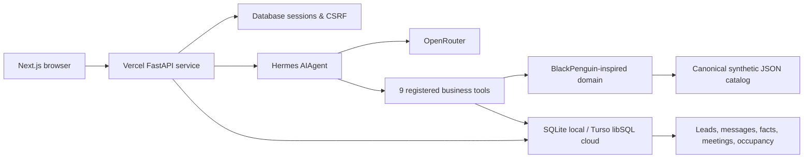

# Testing Hermes Agent — Real Estate Evaluation Lab (v4)

A **single-screen evaluation workspace** for [Nous Research Hermes Agent](https://github.com/NousResearch/hermes-agent), OpenRouter, a **synthetic** real-estate catalog modeled after BlackPenguin's Project/Property Type/Unit/Lead contracts, and a shared advisor calendar.

**Stack:** Next.js 15 + React 19 + FastAPI + upstream Hermes `AIAgent` + OpenRouter `openai/gpt-4o-mini` + SQLite (local) / Turso **libSQL** (Vercel). The source is independent research code, not Nous Research or BlackPenguin production software.

> [!IMPORTANT]
> Use **fictional leads**. Do not enter customers' real contact details. Booking, people, properties, inventory, calendar fixtures, and PDFs are synthetic; this demo does **not** sync Google Calendar or contact humans. OpenRouter calls may be billable.

## What changed from v3

- **Single workspace, one sidebar link:** Inventory / Calendar left, Hermes chat center, per-lead structured state right.
- **Complete approved-property inspector:** type/model/unit distinctions, areas, prices, inventory timestamps, verified typed features, local demo images/PDFs, and safe source JSON.
- **No contextual "Ask Ava" button:** all conversational actions stay in chat. AI messages render Markdown safely; only locally published `/demo-assets/` URLs are clickable.
- **Real calendar UI:** day/week, any subset of advisors, daily time-grid, multi-advisor events, available slots, occupied visits, buffers, viewer-local date/time marker, optional project-time mode, and expanded view. Refreshed every 20 seconds and after chat actions.
- **Auth and durable leads:** invite-code login for isolated evaluators; strong password for administrators. Create leads with first/last name, email, phone; reopen all leads belonging to the same evaluator session; admins can inspect all.
- **Shared scheduling:** 45-minute appointments plus 15-minute buffer; candidates every 30 minutes; three expiring proposals without holds; automatic revalidation; atomic 15-minute advisor occupation keys to reject overlapping concurrent bookings across visitors.
- **Permanent admin deletion:** removes the lead, conversations, messages, Hermes histories, fact evidence, interest records, offers, meetings and occupancy allocations. Other tabs get 404 and clear their state on refresh; no application-level historical viewer remains.
- **No browser-held signed transcript:** the backend owns Hermes continuation history and DB sessions are revocable. `DEMO_SIGNING_SECRET` now also signs the CSRF token.

## Architecture



**Source of truth:** `shared/blackpenguin/*.json` owns the synthetic project, types, units, features, assets, advisors, availability and policy. Run `python scripts/build_catalog_from_blackpenguin.py` to regenerate the two read-only copies of the approved public catalog. The backend's database owns mutable lead/conversation/booking state. **Do not commit database files or secrets.**

Upstream Nous `hermes-agent` is pinned to commit `b94cb8e2c4ebf2a8c7688cf676c3cf9899584adb` for Python 3.12 compatibility; it is a sizeable dependency for serverless. Its writing of logs/sessions is redirected to `HERMES_HOME=/tmp/hermes-agent` in Vercel/AWS Lambda automatically when this variable is not set.

## Local setup

Requirements: Node.js 20+, Python 3.12, `pip`, Git, OpenRouter API key.

```bash
cd backend
python -m venv .venv
source .venv/bin/activate   # PowerShell: .venv\Scripts\Activate.ps1
pip install -r requirements.txt
# Set OPENROUTER_API_KEY, DEMO_SIGNING_SECRET, DEMO_ACCESS_CODE, DEMO_ADMIN_PASSWORD
# in your shell/environment (do not commit them).
uvicorn main:app --reload --port 8000
```

The first authorized request initializes `data/hermes_demo.sqlite3` (standard Python `sqlite3`). It also seeds two **absolute-time** synthetic occupied appointments once, including one on an advisor's other project. Existing appointments will never move merely because a day passes or you restart the app.

```bash
cd frontend
npm install
LOCAL_API_URL=http://127.0.0.1:8000 npm run dev
```

Open `http://localhost:3000`, choose Evaluator, enter the private code and create a fictional lead. The evaluator's identity lives in a seven-day HttpOnly, SameSite=Lax cookie; logging out and logging in anew as an evaluator creates an **independent** workspace. Administrators see all existing leads.

Tests (Hermes calls mocked, no OpenRouter charge):

```bash
python scripts/build_catalog_from_blackpenguin.py
PYTHONPATH=backend python -m pytest -q backend/tests
cd frontend && npm run build
```

## Deploy to Vercel with Turso libSQL

**Important:** Vercel Functions' `/tmp` is ephemeral and not shared. Do **not** set `DEMO_DATABASE_PATH=/tmp/demo.db` for persistent state. Use a remote database accessible by every instance.

1. Create a database at [Turso](https://turso.tech/) using the **libSQL** engine. With the Turso CLI, `turso db create hermes-agent-lab` without `--tursodb` creates a libSQL database. Check current Turso documentation if the default engine changes.
2. Obtain its `libsql://...` URL and create a database auth token. Store the URL and token privately.
3. Import the entire repository into Vercel at root `./`, keeping its `vercel.json` **Services** configuration (Next.js frontend + FastAPI backend).
4. Add these **Production** environment variables in **Vercel → Project → Settings → Environment Variables**:

| Variable | Required | Notes |
|---|---|---|
| `OPENROUTER_API_KEY` | Yes | Secret API key; requires usable credit/permissions. |
| `MODEL_NAME` | Optional | `openai/gpt-4o-mini` by default. |
| `DEMO_SIGNING_SECRET` | Yes | Unique high-entropy string, >=32 characters. |
| `DEMO_ACCESS_CODE` | Yes | Evaluator invite code, not the admin password. |
| `DEMO_ADMIN_PASSWORD` | Yes for admin | Separate high-entropy string, >=16 characters. |
| `TURSO_DATABASE_URL` | Yes | `libsql://...` URL from a Turso libSQL database. |
| `TURSO_AUTH_TOKEN` | Yes | Database token; never expose with `NEXT_PUBLIC_`. |
| `HERMES_HOME` | No | Automatically `/tmp/hermes-agent` on Vercel; may be set explicitly. |

5. Save and **redeploy**. Visit `/api/health` (`database_mode: "turso"` only indicates configuration; not connectivity), then sign in, create a lead and request calendar availability.
6. Check **Vercel Runtime Logs** if chat fails. The initial app startup and Hermes's first API request may expose further packaging/runtime issues.

Database initialization is lazy on first authorized request and is idempotent for a single deployment. On first use the database creates all tables and seeds the synthetic fixed-time fixtures once; later deployments preserve leads and appointments.

**A new Turso-engine database (`--tursodb`) uses a different driver.** This repository's remote adapter specifically uses the `libsql` Python driver for libSQL databases. Provision the **libSQL** flavor or adapt the storage driver after validating its transactional/occupancy behavior. Do not silently use a local file on Vercel as a fallback.

## API contracts

| Method | Endpoint | Access |
|---|---|---|
| GET | `/api/health` | Public, configuration summary only |
| GET | `/api/catalog` | Public, approved synthetic catalog only |
| POST | `/api/auth/login` | Evaluator code or administrator password |
| GET | `/api/me` | Active signed-in session and CSRF token |
| POST | `/api/auth/logout` | Signed-in, CSRF header |
| GET | `/api/leads` | Own leads; admin sees all |
| POST | `/api/leads` | Signed-in + CSRF; four contact fields |
| GET | `/api/leads/{id}` | Owner or administrator |
| POST | `/api/leads/{id}/chat` | Owner or administrator + CSRF; only message text allowed |
| GET | `/api/calendar?start=YYYY-MM-DD&days=7&advisor_ids=ADV-01,ADV-02` | Signed-in; other visitors' contact details redacted |
| DELETE | `/api/admin/leads/{id}` | Administrator + CSRF only; hard deletion |

All state-changing authenticated requests require `X-Demo-Csrf`. The browser's session cookie is HttpOnly and request responses include `Cache-Control: no-store`. The browser never posts Hermes tool history.

### Business tools

- `get_project_overview`
- `evaluate_properties_for_lead`
- `get_unit_media`
- `update_lead_profile`
- `track_property_interest` (discussed / considering / explicitly interested)
- `get_available_visit_slots`
- `book_onsite_visit`
- `cancel_onsite_visit`
- `reschedule_onsite_visit`

Offers expire after 30 minutes and **do not hold** any capacity. A booking is accepted only on subsequent explicit consent. Two concurrent sessions may both *see* an open slot, but the first successful database transaction reserves all four 15-minute occupancy buckets. A conflicting commit is rolled back and the API responds 409, never confirming an overlapping booking.

### Permission and deletion model

Evaluator sign-in generates a random owner identity bound to a seven-day session. Leads created in that identity can be revisited until the session expires or the evaluator logs out. There is **no cross-device evaluator account recovery** with only an invite code; the admin can view all leads. Only the server-side admin role can delete a lead, and deletion removes all application-owned lead data and releases all its booking occupancy keys transactionally. Historical browser tabs may temporarily show already-rendered messages until the next refresh/poll; endpoints immediately reject access after deletion.

Application-level deletion **cannot purge Turso/provider backups, external AI-provider logs, browser screenshots, already downloaded exports, or third-party retention policies**. Use only synthetic leads, do not log message content to Vercel, rotate demo credentials if disclosed, and review privacy/retention settings with service providers. For a commercial app add a real identity provider, rate limiting, governance, and stronger administrative authentication.

### Known limits / deliberately out of scope

- **No real Google Calendar** or human follow-up, email, WhatsApp, SMS, property sale, or payments.
- **No real users' PII**: all data is fictional. Shared evaluator code is not full authentication. Admin login is password-only and requires deployment edge rate limiting for public exposure.
- 14 messages per lead in the interactive evaluation. A new lead starts a new evaluation, so the OpenRouter spend limit is **not** a global hard cap.
- Remote Turso transactional correctness (including multi-instance Vercel concurrency), serverless Hermes cold-start/size limits and full Next.js production build must be verified with **real deployed credentials**, not inferred from local SQLite tests.
- Existing v3 browser `sessionStorage` sessions are **not migrated** to v4; use new fictional leads.
- If account access to GitHub does not authorize writes, apply the supplied patch locally. A PR/deployment has not been performed by generating this archive.

For details, see [`docs/V4_ARCHITECTURE.md`](docs/V4_ARCHITECTURE.md).
