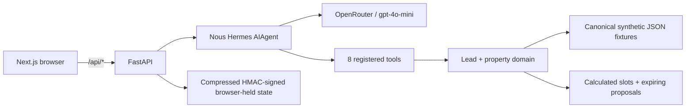

# Hermes Agent — Real Estate Sales Lab

**A BlackPenguin-inspired experiment with Nous Research `hermes-agent`, OpenRouter, a structured property catalog, live lead-fact evidence, and calculated showroom appointments.**

> [!IMPORTANT]
> **Synthetic research demo, not a production CRM.** Properties, advisors, leads, media, offers and bookings are fictional. This project is independent of Nous Research and is not an official BlackPenguin deployment. Do **not** submit real names, phone numbers or confidential information during the demo.

## What is being tested?

A synthetic lead from a Meta campaign chats **in English** with **Ava**, an advisor backed by the real Nous Research `AIAgent` runtime. The three-pane browser shows, side by side:

| Property inventory | Interactive Hermes chat | Live lead intelligence |
|---|---|---|
| Project profile, four publishable units, property types, prices, typed features, images and PDFs | Multi-turn qualification, budget/timeline matching, media requests, slot offers and confirmation | Declared facts with message provenance, matching units, expiring slot offers, simulated meeting and tool activity |

The agent is designed to:

1. Capture explicitly declared commercial facts with their source-message reference (`sales-lead-profile/2.0`).
2. Qualify **budget and intended purchase timeline**, then match verified, available units.
3. Show only approved synthetic sales media. A reserved unit **H-102 is excluded** from the public catalog.
4. Avoid fabricated financing rates, installments and terms; human advisors handle financing questions at the visit.
5. Search available appointments from team assignments, weekly windows, date exceptions, advisor-wide busy periods, **45-minute visits**, **15-minute buffers**, and **30-minute search steps**.
6. Offer **at most three options**, expiring after **30 minutes**, without placing a temporary hold.
7. Create a **simulated** booking only after a new, explicit user confirmation and fresh slot validation. A general project visit **does not require a unit**.
8. Support **simulated cancellation and rescheduling**, with a replacement Meeting and linked operation receipt rather than overwriting visit history.

## Frontend design language

The interface follows the **documented BlackPenguin frontend design system** (as-is, November 2026), implemented here in **Next.js** rather than copying its Angular components:

- **Dark-first**: `#0A0A0A` background, `#131313` / `#161616` surfaces.
- **Amber**: `#E99E10` primary accent (called `secondary` in the BlackPenguin Tailwind tokens).
- **Typography**: Space Grotesk (300–700); Material Symbols Outlined in navigation; subtle outlined UI icons.
- **Layout**: 16rem BlackPenguin-style sidebar at large widths, three-pane inventory/chat/context workspace, subtle borders, liquid-glass-like surfaces and mobile stacking.
- **States**: amber focus/selection, green success, red errors, explicit synthetic-demo and *not-booked* states.

See [docs/DESIGN_SYSTEM.md](docs/DESIGN_SYSTEM.md) for the concrete token mapping and deviations.

## Architecture



**The agent is real, not a frontend imitation:** `backend/app/hermes_runtime.py` imports `AIAgent` from upstream `run_agent.py` and registers tools using the Hermes tool registry. Upstream is pinned to commit:

`b94cb8e2c4ebf2a8c7688cf676c3cf9899584adb` (Python 3.11-compatible tree).

This upstream dependency is heavy for serverless deployments; **a successful Vercel deployment and live OpenRouter turn have not been validated** in this environment.

### Business tool contracts

| Tool | Purpose |
|---|---|
| `get_project_overview` | Read published project facts and amenities |
| `evaluate_properties_for_lead` | Filter publishable units by budget, bedrooms and interpreted purchase deadline |
| `get_unit_media` | Provide approved image and PDF URLs, including explicit unavailable resources |
| `update_lead_profile` | Store lead declarations, provenance, history and UI projection |
| `get_available_visit_slots` | Calculate up to three offered slots with a `proposal_id` and 30-minute expiry |
| `book_onsite_visit` | Revalidate a previously offered option and create a simulated `Meeting` plus booking operation after explicit approval |
| `cancel_onsite_visit` | Explicit cancellation, preserving the meeting history and writing a synthetic cancellation operation |
| `reschedule_onsite_visit` | Confirm a new proposal, cancel the original Meeting as rescheduled and create a linked replacement |

The system limits Hermes to the dedicated domain toolset, disables terminal/file/web/browser toolsets and does not expose internal asset sources or OAuth credentials.

### Canonical data contracts

Each independently meaningful business entity has one file in `shared/blackpenguin/`:

| File | Owner of |
|---|---|
| `project.json` | Identity, profile, approval, phases and marketing context |
| `property_types.json` | Sellable residential models |
| `units.json` | Physical units, prices, inventory status and inventory events |
| `features.json` | Feature definitions and confirmed project-wide feature values |
| `assets.json` | Sources, gallery bindings, approved sales materials and coverage |
| `team.json` | Company sales users and project-user assignments |
| `availability.json` | Weekly windows, extra availability and unavailable date exceptions |
| `meetings.json` | Synthetic **existing** occupied intervals, including an advisor's booking at another project |
| `scheduling_policy.json` | Visit duration, buffer, search step, expiration and confirmation rules |
| `lead.json` | Blank BP-shaped lead/dialogue episode template (not a production Lead row) |
| `lead_example.json` | Sample progression and sourced facts, documentation only |
| `references/` | Preserved uploaded synthetic examples and prior demo-advisor format |

The browser's `shared/catalog.json` and backend `backend/app/catalog.json` are **derived publication projections**: do not edit them manually. `backend/app/{lead,team,availability,meetings,scheduling_policy}.json` are deployment **build mirrors** for Vercel Services package isolation; the `shared/blackpenguin/` files are canonical for these fixtures.

Regenerate and validate from the repository root:

```bash
python scripts/build_catalog_from_blackpenguin.py
PYTHONPATH=backend python -m pytest -q backend/tests
```

The unmodified BlackPenguin source examples are **illustrations, not production database dumps**. The Project v2 proposal contains additions **not implemented in the referenced BlackPenguin code**. This app's normalized fixtures and `availability_exceptions` are independent research-contract extensions, not an API migration.

See [docs/ARCHITECTURE_DECISIONS.md](docs/ARCHITECTURE_DECISIONS.md) for the domain rules and tradeoffs.

## Deploy the monorepo on Vercel

This project is prepared for **Vercel Services** (multi-service deployments; product availability and beta constraints may change). A single repository root `vercel.json` defines **frontend Next.js** and **backend FastAPI** services under one public URL.

1. Upload the **contents** of this directory to a GitHub repo named `hermes-agent-real-estate-lab`.
2. Open [Vercel → New Project](https://vercel.com/new), import the repository and select its **root** (`./`), not `frontend/`.
3. Ensure Vercel recognizes the root `vercel.json` Services configuration.
4. Set the backend environment variables (at least `OPENROUTER_API_KEY`, `DEMO_SIGNING_SECRET`, and preferably a visitor `DEMO_ACCESS_CODE`). Never use a `NEXT_PUBLIC_` prefix for secrets.
5. Deploy, check the backend health route `https://<your-app>.vercel.app/api/health`, and try a real conversation.
6. Share the resulting `.vercel.app` link. If `DEMO_ACCESS_CODE` is configured, share that code separately.

```dotenv
OPENROUTER_API_KEY=sk-or-YOUR-KEY
MODEL_NAME=openai/gpt-4o-mini
DEMO_SIGNING_SECRET=generate-a-random-value-at-least-32-characters-long
DEMO_ACCESS_CODE=optional-private-invite-code
```

**Potential deploy blocker:** Hermes bundles substantial Python dependencies. Serverless cold starts, size and runtime constraints can prevent building or running on the free tier. If that occurs, keep Next.js on Vercel and deploy the Python process to a conventional Python host. That fallback requires adapting the same-origin API routing.

Vercel's **Hobby plan is for personal, noncommercial use**; running this demo may still incur **OpenRouter API charges**. The demo access code is only a basic access barrier, not a global quota, anti-abuse or authentication system.

## Local development

Prerequisites: Node.js 20+, Python 3.11+, Git, OpenRouter API key.

```bash
# Terminal 1: FastAPI
cd backend
python -m venv .venv
source .venv/bin/activate
pip install -r requirements.txt
export OPENROUTER_API_KEY='sk-or-...'
export DEMO_SIGNING_SECRET='long-random-development-secret'
uvicorn main:app --reload --port 8000
```

```bash
# Terminal 2: Next.js
cd frontend
npm install
LOCAL_API_URL=http://127.0.0.1:8000 npm run dev
# http://localhost:3000
```

Windows PowerShell: `.venv\Scripts\Activate.ps1`, `$env:OPENROUTER_API_KEY='...'`, `$env:DEMO_SIGNING_SECRET='...'`, `$env:LOCAL_API_URL='http://127.0.0.1:8000'`.

## What the demo does **not** guarantee

- **One browser session** with up to 14 user turns; this is a *soft* limit, **not** one-use-per-person or a global rate limit. Another browser/session can start again.
- The signed, compressed session token stores simulated conversation history and state in the browser. It is **tamper-evident, not encrypted**; no real PII should be entered. The server does **not trust arbitrary history sent by the client**.
- The accepted booking, cancellation or reschedule is valid **only within that browser session**. Other visitors' bookings are not synchronized. There is **no persistent database, locking across sessions, Google Calendar event, WhatsApp message, salesperson notification, or real estate reservation**.
- The scheduling example contains **fixture** busy intervals (including cross-project occupancy), not live external Google FreeBusy. Any offered slot is an illustration of the calculation.
- This is not a production reconciliation of BlackPenguin's real schema, inventory, contracts or CRM. The demo does not run the BlackPenguin scoring engine.
- `sales-dialogue/1.0` and `sales-lead-profile/2.0` are approximated in JSON for educational instrumentation. Real production schemas and migration steps are out of scope.

## Testing status

`PYTHONPATH=backend pytest -q backend/tests` passes 31 backend/domain tests as of this revision. Tests include publication filtering, domain relationships, source-evidence revisions, tenant-linked team assignments, global busy conflicts, explicit unavailable exceptions, buffer overlap, proposal expiration, visit confirmation, simulated cancel/reschedule receipts, signed-token tampering and API behavior with stubbed Hermes responses.

The frontend TypeScript/JSX parser reported **zero syntax diagnostics**, but the **complete Next.js install/build was not verified** here because package installation timed out. Hermes against a real OpenRouter key, as well as a deployed Vercel build, still require end-to-end validation.

## License and attribution

MIT. Independent educational proof of concept using the upstream [Nous Research Hermes Agent](https://github.com/NousResearch/hermes-agent). The style conventions are adapted from an uploaded documentation of BlackPenguin's existing design system; this repository does not reproduce BlackPenguin's private frontend code or production data.
