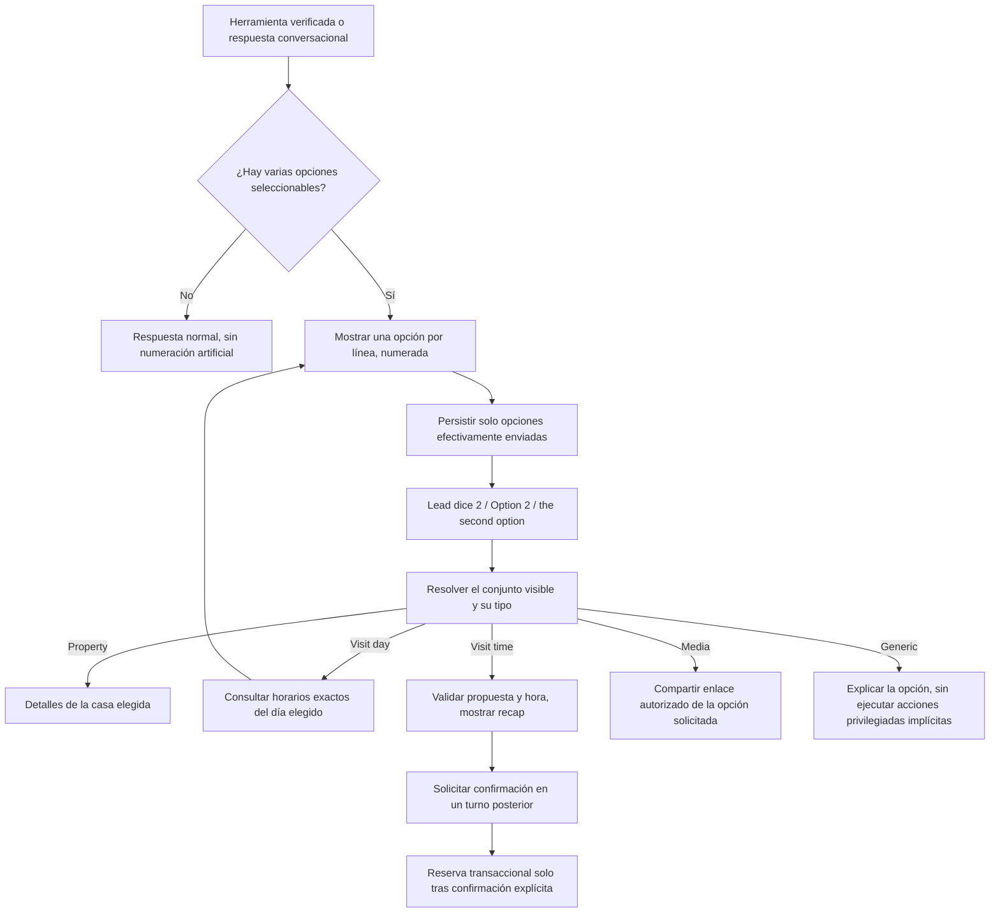

# Hermes v13.3.3 — Contextual Choice Resolver (Upload Ready)

## Propósito

Una opción ordinal (`2`, `Option 2`, `The second option`, `la segunda`) se refiere a la **segunda opción del conjunto pertinente realmente mostrado al lead**. No significa necesariamente una propiedad. Corrige el caso reproducido en `hermes-60442085-conversation.json`, en el que H-201 tenía cuatro fechas disponibles y seleccionar la segunda fecha terminaba preguntando por una casa.

## Cambios incluidos

- `contextual_choices.py`: contratos y resolución de conjuntos de propiedades, días de visita, horas, medios (fotos/PDF) y otras listas explícitamente seleccionables. Fuentes verificadas para fechas/horas; no se fabrican disponibilidades.
- `v1333_contextual_choices.py`: adaptación idempotente instalada **después** de v13.3.2. Mantiene el grafo de Hermes y las llamadas existentes de dominio, sin instalar nada ni ejecutar scripts desde un ZIP.
- `__init__.py`: importa ambos adaptadores al cargar `app`.
- `test_v13_3_3_contextual_choices.py`: pruebas de selección contextual y límites del flujo de reserva.

## Flujo de mensajes



### Fechas y horarios

Un `get_available_visit_slots` sobre un rango de días devuelve `available_dates`. Esos días se presentan en su orden verificado, por ejemplo:

```text
Available days to visit H-201 (Lima):

1. Monday, November 23, 2026
2. Tuesday, November 24, 2026
3. Wednesday, November 25, 2026
4. Thursday, November 26, 2026

Which day works best for you? I will then check specific times.
```

`Option 2` identifica **2026-11-24**, manteniendo `visit_draft.unit_id=H-201`, `conversation_focus.unit_id=H-201` y `conversation_phase=visit_planning`. Se consulta la fecha elegida usando la misma ocupación global de asesores que ya obtiene `main._finish_turn`, antes de pedir a Hermes que redacte la respuesta.

El resultado de horas exactas se presenta también como lista numerada. Elegir `Option 2` de esa lista llama al contrato ya existente `select_visit_time`, que valida `proposal_id`, vigencia, propiedad, día, hora y el consentimiento de elección en el contexto del mensaje realmente entregado. **No reserva automáticamente:** se prepara la recapitulación y se exige una confirmación explícita *en otro turno* mediante el mecanismo preexistente.

### Elecciones de fotos / PDF

Cuando una pregunta ofrece fotos y PDF como alternativas, ambas deben existir en `unit_media` antes de crear un menú seleccionable. Elegir una opción comparte únicamente el enlace público aprobado que corresponde a ella, y la validación de URL sigue ejecutándose con `delivery_policy`.

### Listas genéricas

Las listas de opciones conversacionales en viñetas se pueden numerar y su elección se entrega a Hermes como contexto verificado de qué etiqueta se escogió. **No** conceden permiso por sí mismas para modificar preferencias permanentes, enviar enlaces restringidos ni reservar citas.

## Persistencia sin migración SQL

El `state_json` ya persistido por el backend incluye ahora:

```json
{
  "last_presented_choice_set": {
    "type": "visit_day",
    "unit_id": "H-201",
    "source_tool": "get_available_visit_slots",
    "source_reply_message_id": "uuid-del-mensaje-saliente",
    "timezone": "America/Lima",
    "options": [
      {"index": 1, "date": "2026-11-23", "label": "Monday, November 23, 2026"},
      {"index": 2, "date": "2026-11-24", "label": "Tuesday, November 24, 2026"}
    ]
  },
  "choice_set_history": [],
  "choice_set_initialized": true
}
```

La estructura es un **ejemplo de esquema**, no datos reales de una cita. Se guardan como máximo ocho conjuntos de opciones recientes. `last_presented_property_options` permanece disponible para compatibilidad con v13.3.2. Los conjuntos consumidos se invalidan para no rescatar inadvertidamente un menú inmobiliario antiguo.

## Reglas de seguridad y continuidad

1. La numeración refleja el **mensaje saliente realmente enviado**, no el resultado interno del LLM o del calendario. No se guarda un menú que el lead nunca vio.
2. Para visitas, una selección de día implica buscar horas para ese día y casa, pero no escoger una hora ni reservar.
3. La selección de hora solo se acepta si coincide con un `booking_proposal` válido, todavía vigente y efectivamente mostrado; la confirmación de la cita es independiente.
4. Si el lead corrige con una fecha explícita, esa fecha prevalece sobre una ordinal ambigua y el calendario vuelve a verificar disponibilidad.
5. La memoria de opciones no altera presupuestos ni criterios permanentes.
6. Una referencia ordinal fuera de rango produce una aclaración del tipo correcto; **nunca** se resuelve recurriendo al ranking de otra lista.
7. El visor y SMS reciben los saltos de línea reales; la segmentación física de SMS no se confunde con los mensajes conversacionales.

## Compatibilidad con conversaciones existentes

- Si no existe memoria tipada, la selección de propiedades sigue usando el snapshot de v13.3.2.
- Si la última respuesta legada contiene una lista visible de días y `last_slot_search` fue exitoso para la casa visitada, el resolvedor puede reconstruir ese menú de fechas; la fecha se vuelve a verificar antes de ofrecer horarios.
- Si el último mensaje fue ya un error genérico que borró la referencia visible (como en la conversación proporcionada), **no se adivina** qué significaba `Option 2`. Una corrección explícita como `November 24` permite recuperar el flujo.

## Validación recomendada en Preview

1. Pedir dos casas y escoger la segunda: siguen funcionando H-204 / H-101.
2. Seleccionar H-201, solicitar días para la próxima semana y escoger `2`, `Option 2`, `The second option` o `la segunda`: misma segunda fecha; ninguna re-pregunta de propiedad.
3. Mostrar horas del día elegido y seleccionar el número 2: recap con hora exacta, **ninguna reserva confirmada**.
4. Responder después `Yes, I confirm` y verificar el flujo original de transacción y ocupación.
5. Abrir otro menú y verificar que una ordinal se resuelva contra el último conjunto relevante, no uno obsoleto.
6. Elegir una opción fuera de rango y pedir otra fecha no disponible: deben fallar con claridad, sin inventar citas.
7. Verificar que los mensajes contienen saltos de línea reales y que los números aparecen uno por línea.

## Límites de la entrega

Este ZIP contiene archivos completos para GitHub Upload files y no toca el repositorio remoto ni el despliegue. Las pruebas unitarias del resolvedor se pueden ejecutar sin credenciales; la suite de integración requiere un checkout real con dependencias instaladas. El comportamiento en Hermes/OpenRouter/Turso se verifica después de desplegar en Preview.
